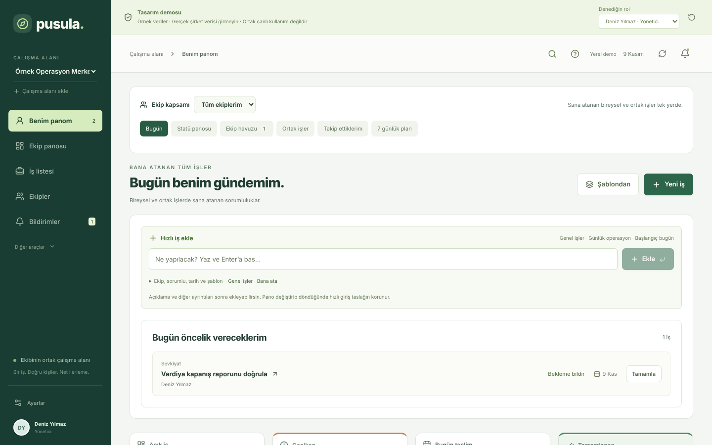
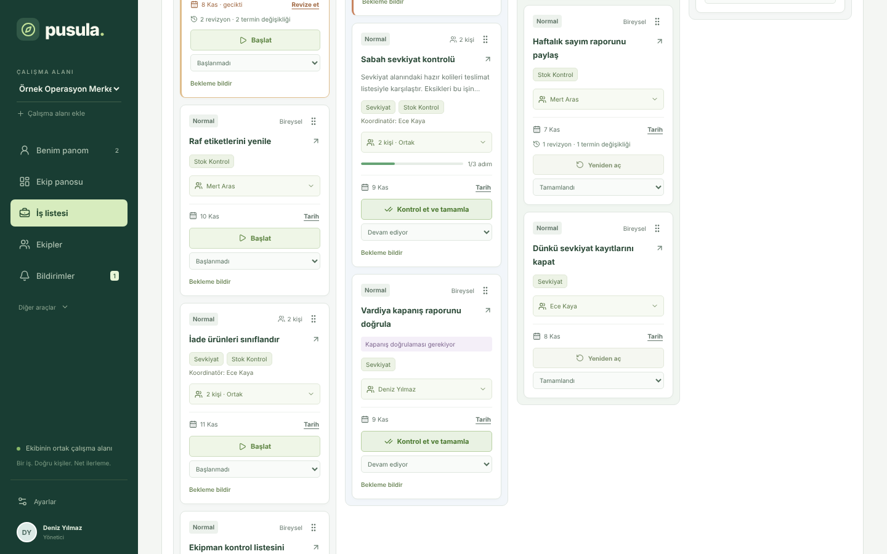
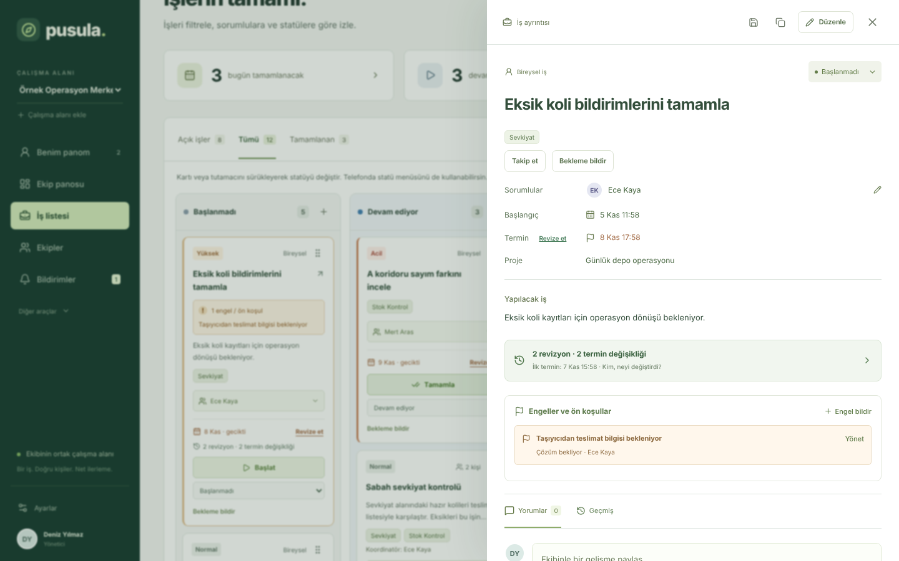
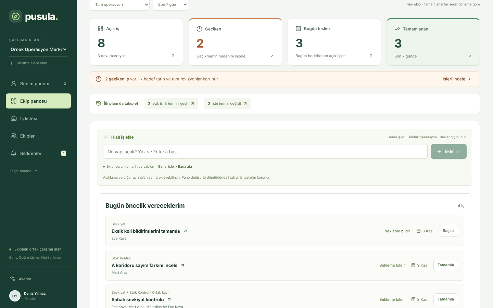
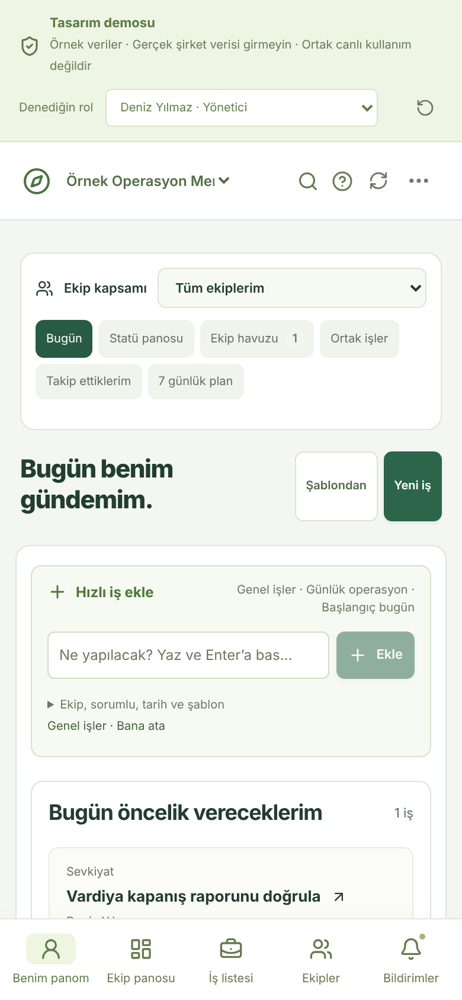

# Pusula | İş ve Ekip Takip Sistemi

Pusula, operasyon ekiplerinin işlerini, sorumlularını, terminlerini ve işi durduran engelleri tek ekranda izlemesi için tasarlanmış Türkçe bir iş takip uygulamasıdır. Depo, sevkiyat ve stok kontrol gibi vardiyalı ekipler düşünülerek hazırlandı.

**Canlı sürüm (sunucu, Claude bağlantısı):** https://pusula.ysfdurak.com — Google hesabınla gir; sana ait, kurgusal bir depo ekibiyle dolu bir çalışma alanı açılır ve 7 gün sonra tümüyle silinir. Aynı sunucu Claude'a MCP üzerinden bağlanır: 13 araç ve sohbetin içinde açılan tıklanabilir "Benim panom" (MCP App). Bağlantı adresi: `https://pusula.ysfdurak.com/mcp`. Ayrıntı: [docs/MCP.md](docs/MCP.md), kurulum: [docs/SUNUCU_KURULUMU.md](docs/SUNUCU_KURULUMU.md).

**Sunucusuz tarayıcı demoları:**
- Örnek verilerle demo: https://ysfdurak.github.io/pusula-is-takip/
- Pilot önizlemesi (boş başlar): https://ysfdurak.github.io/pusula-is-takip/pilot-onizleme/

> **English:** add `?lang=en` to any address (e.g. https://pusula.ysfdurak.com/?lang=en) or use the English button in the sidebar. Nasıl çalıştığı: [docs/CEVIRI.md](docs/CEVIRI.md).
>
> Tarayıcı demolarında veriler yalnızca sizin tarayıcınızda saklanır, sunucuya gitmez. Hiçbirine gerçek şirket verisi girmeyin.
> Demo kurgusal bir depo ekibiyle açılır. Pilot önizlemesi şirket pilotundaki gibi boş açılır: yönetici sizsiniz, ekipleri ve kişileri siz kurarsınız, "Kullanıcı olarak dene" ile ekip üyesinin gözünden bakarsınız.

### Telefondan denemek

Telefon kamerasıyla okutun; uygulama tarayıcıda açılır, kurulum gerekmez. Paylaşmak için bağlantıyı da gönderebilirsiniz.

| Pilot önizlemesi (boş başlar) | Demo (örnek verilerle) |
|:---:|:---:|
|  |  |
| [ysfdurak.github.io/pusula-is-takip/pilot-onizleme/](https://ysfdurak.github.io/pusula-is-takip/pilot-onizleme/) | [ysfdurak.github.io/pusula-is-takip/](https://ysfdurak.github.io/pusula-is-takip/) |

İpucu: Telefonda tarayıcı menüsünden "Ana ekrana ekle" ile kısayol oluşturulabilir. Önizlemede veriler o telefonun tarayıcısında kalır; bilgisayardaki önizlemeyle paylaşılmaz. Ekip olarak birlikte denemek için pilot sunucusu gerekir.



## Ne çözer?

Operasyon ekiplerinde işler WhatsApp, e-posta ve Excel arasında dağılır. Kimin neyi üstlendiği belirsizleşir, geciken iş ancak iş işten geçince fark edilir. Pusula bunun için:

- **Herkese kendi gündemini** gösterir: bugün neye öncelik vereceğini, geciken ve bugün teslim olan işleri.
- **Ekip liderine tek bakışta durumu** verir: açık, geciken ve sahipsiz işler, 7 günlük teslim takvimi.
- **İlk termini kaybetmez:** termin revize edilse bile ilk hedef tarih ve her değişikliğin gerekçesi saklanır. "İlk termine göre zamanında tamamlanan" ile "güncel termine göre" oranı ayrı ölçülür.
- **Engeli görünür kılar:** işi durduran konu, çözüm sorumlusuyla birlikte işin üstünde durur.

## Özellikler

| Alan | Neler var |
|---|---|
| Panolar | Benim panom, Ekip panosu, 7 günlük plan, ekip havuzu, ortak işler, takip edilenler |
| İş | Hızlı ekleme (yaz + Enter), şablondan iş, bireysel / ortak iş, tek veya çoklu sorumlu, öncelik, termin ve revizyon gerekçesi, kontrol listesi, onay (doğrulama) adımı, süre takibi, tekrarlanan iş (her gün, hafta içi, haftalık, aylık), dosya ve fotoğraf ekleme |
| Görünümler | Statü panosu (sürükle-bırak kanban), liste, toplu işlem, arama (Ctrl/⌘ K), filtreler, Excel'e aktarma (filtrelenmiş liste) |
| Kayıtlar | Projeler, engeller, kararlar, yorumlar, işlem geçmişi |
| Ekip | Birden fazla ekip, kişi rehberi, roller (yönetici, ekip üyesi, görüntüleyici) |
| Bildirim | Uygulama içi bildirimler ve Jira benzeri Outlook e-postaları: atama, durum, tamamlama, yorum; hafta içi sabah özeti ([kurulum](docs/OUTLOOK_BILDIRIMLERI.md)) |
| Veri | JSON dışa aktarma, örnek verileri sıfırlama |
| Claude (MCP) | 13 araç (7 okuma, 6 yazma) ve sohbet içinde açılan pano; web arayüzüyle aynı kurallar ve yetkiler. Üye yönetimi, silme ve ekler bilerek yapay zekâya açılmadı ([docs/MCP.md](docs/MCP.md)) |
| Dil | Türkçe ve İngilizce web arayüzü (`?lang=en`); MCP araçları ve e-postalar şimdilik Türkçe |

<p>


</p>
<p> </p>

## 5 dakikalık demo

1. **Benim panom:** Sağ üstteki "Denediğin rol" menüsünden Deniz Yılmaz (yönetici) ile başla. Hızlı iş kutusuna bir iş yazıp Enter'a bas.
2. **Ekip panosu:** 2 geciken işi ve "İlk planı da takip et" kutusunu gör. Termini iki kez revize edilmiş *Eksik koli bildirimlerini tamamla* işini aç.
3. **İş listesi → Pano:** Bir kartı sürükleyerek statüsünü değiştir. *Vardiya kapanış raporunu doğrula* işini açıp tamamlanmadan önce doğrulama beklediğini gör.
4. **Rol değiştir:** Selin Aydın (görüntüleyici) ile aynı ekranlara bak; düzenleme hakları kapanır.

Ayrıntılı senaryolar: [docs/DEMO_SENARYOLARI.md](docs/DEMO_SENARYOLARI.md)

## Kaynak kod ve geliştirme

Uygulama React 19 + Vite ile yazılmıştır; derleme tek bir HTML dosyası üretir ve internetsiz açılabilir.

```bash
npm install
npm run dev            # geliştirme sunucusu
npm test               # iş kuralı birim testleri
npm run build          # dist/index.html  → tasarım demosu
npm run build:preview  # dist-preview/index.html → pilot önizlemesi (boş başlar, tarayıcıda)
npm run build:pilot    # dist-pilot/index.html → sunucu modu (/api/workspace)
npm run dev:api        # pilot derlemesini örnek verilerle çalıştırır; e-postalar tmp/mail-preview/ (yalnızca geliştirme)
npm run start:dev      # pilot sunucusu: SQLite + geliştirme girişi, boş çalışma alanı (yalnızca geliştirme)
npm start              # pilot sunucusu (üretim): .env.example ve docs/PILOT_KURULUM.md
```

| Klasör | İçerik |
|---|---|
| `src/App.jsx` | Uygulama kabuğu: durum, veri akışı, gezinme |
| `src/screens/` | Ekranlar: panolar, iş listesi, ekipler, bildirimler, ayarlar, kayıtlar, iş ayrıntısı, formlar |
| `src/components/` | Statü panosu, hızlı iş ekleme, genel arama, ekipler, ekler, çakışma penceresi vb. |
| `src/shared/` | Veri şeması ve iş kuralları, `/api/workspace` servisi, bildirim kuralları, tekrarlanan iş, sabah özeti |
| `src/demo/demoServer.js` | Tarayıcı içi örnek sunucu; `/api/workspace` sözleşmesinin başvuru uygulaması |
| `src/lib/` | Pano istatistikleri, çakışma raporu, tarih biçimleri, etiketler |
| `server/` | Pilot sunucusu: Microsoft girişi, oturum, SQLite, yedek, API ([kurulum](docs/PILOT_KURULUM.md)) |
| `server/mail/` | Outlook (Microsoft Graph) e-posta bildirimleri: gönderici, şablon, kuyruk |
| `tests/` | Birim testleri ve tarayıcı duman testi |

İlk sürüm yalnızca derlenmiş bir paket olarak vardı. Bugünkü kaynak o paketten üretildi ve iki sürümün aynı davrandığı otomatik testle doğrulandı. Ayrıntı: [docs/KAYNAK_KOD_DURUMU.md](docs/KAYNAK_KOD_DURUMU.md).

`main` dalına her gönderimde GitHub Actions birim testlerini, derlemeyi ve tarayıcı testlerini (demo, pilot önizlemesi, pilot sunucusu) çalıştırır; hepsi geçerse GitHub Pages'te demo `/` adresinde, pilot önizlemesi `/pilot-onizleme/` adresinde güncellenir.

## Şirket içi pilot

Pilot sunucusu hazır: Microsoft hesabıyla giriş, SQLite veritabanı, Outlook bildirimleri ve sabah özeti, ek dosyalar, otomatik yedek ve Docker imajı. Sunucu kurulmadan önce akışı denemek için [pilot önizlemesini](https://ysfdurak.github.io/pusula-is-takip/pilot-onizleme/) kullanın. BT kurulumu: [docs/PILOT_KURULUM.md](docs/PILOT_KURULUM.md). Şirket tarafında kalanlar (BT, KVKK, pilot planı): [docs/PILOT_IHTIYACLARI.md](docs/PILOT_IHTIYACLARI.md)

## Belgeler

- [Demo senaryoları](docs/DEMO_SENARYOLARI.md)
- [MCP kapısı ve Claude bağlantısı](docs/MCP.md)
- [Sunucu kurulumu: VPS, Google girişi, Claude](docs/SUNUCU_KURULUMU.md)
- [İngilizce arayüz ve çeviri](docs/CEVIRI.md)
- [Mimari, API sözleşmesi ve sınırlar](docs/MIMARI_VE_SINIRLAR.md)
- [Pilot sunucusu kurulumu (BT)](docs/PILOT_KURULUM.md)
- [Pilot ihtiyaçları](docs/PILOT_IHTIYACLARI.md)
- [Outlook e-posta bildirimleri ve BT kurulumu](docs/OUTLOOK_BILDIRIMLERI.md)
- [Kaynak kodun durumu](docs/KAYNAK_KOD_DURUMU.md)
- [Yayın kontrol listesi](docs/YAYIN_KONTROL.md)

## Proje durumu (Kasım 2026)

**Portföy sürümü tamamlandı (0.7.1).** Sunucu sürümü pusula.ysfdurak.com'da Google girişi, ziyaretçi demo alanları ve Claude (MCP) bağlantısıyla çalışıyor. Açık iş, açık PR ve bilinen güvenlik açığı yok (`npm audit`: 0).

Şirket pilotu için yazılım hazır; kalan adımlar şirket tarafında: BT'nin sağlayacağı sunucu ve HTTPS, Microsoft girişi ve Outlook'un gerçek şirket hesabında denenmesi, BT güvenlik değerlendirmesi ve KVKK onayı, iPhone ve Android'de gerçek cihaz denemesi. Ayrıntı: [docs/PILOT_IHTIYACLARI.md](docs/PILOT_IHTIYACLARI.md).

## Portföy notu

**Gösterilen yetkinlikler:** operasyon süreç analizi, iş kuralı tasarımı (sorumluluk, termin revizyonu, onay, engel), kullanıcı akışları, prototipleme, test senaryosu ve yayın otomasyonu.
**Kapsam sınırı:** GitHub Pages'teki sürümler tarayıcıda çalışan demolardır; pusula.ysfdurak.com ziyaretçiye kişisel, süreli demo alanı veren sunucu sürümüdür. Çok kullanıcılı şirket kullanımı için pilot sunucusu (`server/`) şirket altyapısında kurulmalıdır.

## English

**Pusula** is a task and team tracker for shift-based operations teams (warehouse, shipping, stock control): tasks, owners, deadlines and the blockers that stop work, on one screen. It works from the web and from inside a Claude chat.

- **Live:** https://pusula.ysfdurak.com/?lang=en — sign in with Google and get your own workspace with a fictional warehouse team, deleted after 7 days. Connect it to Claude at `https://pusula.ysfdurak.com/mcp`: 13 tools (7 read, 6 write) and a clickable “My board” inside the chat (MCP App). Member management, deletion and attachments are deliberately not exposed to AI.
- **Serverless browser demos:** [sample data](https://ysfdurak.github.io/pusula-is-takip/?lang=en) and an [empty pilot preview](https://ysfdurak.github.io/pusula-is-takip/pilot-onizleme/?lang=en); data stays in your browser.
- **Features:** personal and team boards, Kanban, quick add, templates, shared tasks, checklists, verification step, recurring tasks, attachments; the original deadline and every revision with its reason are kept; blockers with an owner; in-app and Outlook notifications with a morning digest.
- **Language:** the web interface is in English and Turkish; MCP tools and e-mails are in Turkish for now.
- **Stack:** React 19 + Vite, Node.js server with SQLite, Google or Microsoft sign-in, OAuth 2.1 for Claude, Docker and Caddy. One core serves both the web UI and the MCP server, so rules and permissions are the same.

